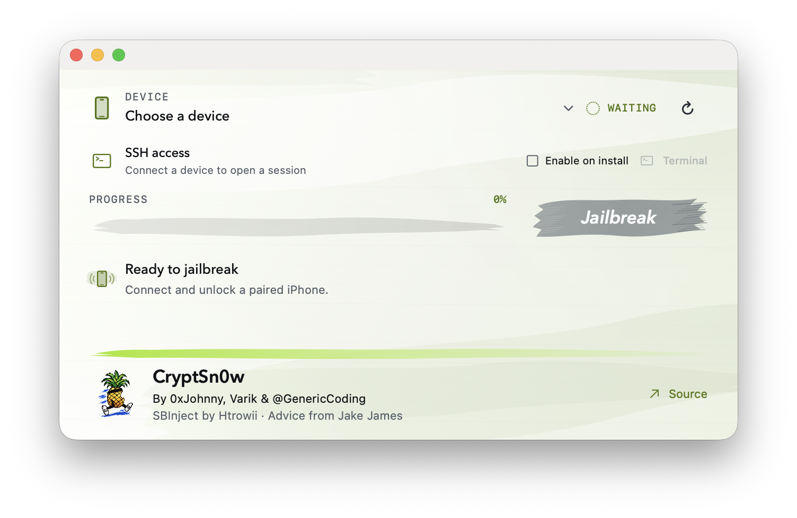

# CryptSn0w

**This project is obsolete.** Apple patched the TSS/Cryptex bug it relied on.
The original signing and installation flow is no longer usable for new
installs. The code is shared for educational purposes and to document the work.

<p align="center">
  
</p>

CryptSn0w packaged an SBInject-based jailbreak as a device-personalized
Cryptex: a disk image with an associated trust cache and an Apple signing
ticket. The original installer obtained that ticket from Apple's signing
service.

The project includes SpringBoard and Settings tweak injection through
ElleKit, Sileo package management, PreferenceLoader, optional root SSH, and
a macOS installer. The bootstrap also contains code to restore its services
after a reboot.

## How it worked

The Cryptex carried the bootstrap, Sileo, ElleKit, SSH, and a fixed set of
loaders. Its trust cache listed the hashes of those binaries. That gave the
project a trusted base, but it did not automatically trust every package
installed later. Adding each new binary to the cache would have required
updating and signing the cache whenever its contents changed.

CryptSn0w used JIT (just-in-time) execution permissions to load supported new
code through that existing base. An already trusted worker, or an
SBInject-managed process, first entered the required debugged state. The
loader then adjusted dyld's signature checks and copied the payload's code
into anonymous memory, making it executable after the copy. Dyld still handled
loading and linking. This ran existing native machine code without adding its
hash to the fixed trust cache.

The broker routed supported package executables and native install scripts
through `codex-exec-worker`. SBInject applied the same approach inside
SpringBoard and Settings, allowing ElleKit to load compatible tweak libraries.
**Installing a supported payload therefore did not require a new Apple-signed
trust cache for that payload.**

Some binaries still needed patching, rehashing, or ad-hoc signing to work with
the loader. They also had to use the supported execution path; they did not
become trusted system-wide. Compatibility depended on the process and OS
build, and changing the fixed bootstrap or loaders still required rebuilding
the installation. This all depended on the original Cryptex bootstrap, whose
installation path is now obsolete.

See the [worker](Dopamine-CryptexBootstrap/CryptexBootstrap/codex_exec_worker.c)
and [SBInject loader](Dopamine-CryptexBootstrap/CryptexBootstrap/SBInject/sbinject_dyld_bypass.c)
for the implementation.

## macOS app

The SwiftUI app runs the same installer as the command line. It requires
macOS 14 or newer and Swift 6.2 or newer to build:

```sh
make app
open dist/CryptSn0w.app
```

Keep the app in `dist/` so it can find the repository, or select the repository
with the app's folder chooser. Retained root SSH access is off by default;
the temporary SSH stage is always part of installation. The app is subject
to the same TSS/Cryptex limitation described above. See
[MacApp/README.md](MacApp/README.md) for its build and UI details.

## Source layout

| Path | Contents |
| --- | --- |
| `Dopamine-CryptexBootstrap/setup.sh` | Dependency setup and build/install entry point |
| `Dopamine-CryptexBootstrap/CryptexBootstrap/` | Cryptex build, deployment, and runtime code |
| `Dopamine-CryptexBootstrap/CryptexBootstrap/SBInject/` | SpringBoard and Settings injection |
| `MacApp/` | SwiftUI installer and app packaging |

The main runtime log was `/var/tmp/codex-dopamine-cryptex-bootstrap.log`.
App launcher and TrollStore registration logs were
`/var/mobile/.sbinject-app-launcher.log` and
`/var/mobile/.sbinject-trollstore-registration.log`.

## Redactions

TSS request construction, personalization, and related installation details
are intentionally omitted. The files retain placeholders for educational
reference.

## Credits

### Maintainers and project contributions

- **[0xjohnny](https://github.com/0xjohnnydev)** — project
  maintainer; the original root SSH proof of concept, Cryptex bootstrap,
  build and signing workflow, Sileo bootstrap and package handling, reboot
  recovery, and later iOS compatibility and runtime fixes.
- **[GenericCoding](https://github.com/GenericCoding)** — project maintainer;
  SBInject and Sileo integration, Settings/PreferenceLoader integration, the
  two-stage installer, native macOS app, TrollStore/app-launcher integration,
  and runtime fixes.
- **[Varik Matevosyan / var77](https://github.com/var77)** — project maintainer;
  device-discovery fixes in the CLI and macOS app so a phone connected over
  both USB and Wi-Fi appears as one device, with USB preferred.
- **[hrtowii](https://github.com/hrtowii)** — the original SBInject proof of
  concept that this port builds on.

Other repository collaborators include
[jakeashacks](https://github.com/jakeashacks), and
[forcequitOS](https://github.com/forcequitOS).

### Upstream projects

- **opa334** — [Dopamine](https://github.com/opa334/Dopamine),
  [opainject](https://github.com/opa334/opainject),
  [litehook](https://github.com/opa334/litehook),
  [libSandy](https://github.com/opa334/libSandy), and
  [AltList](https://github.com/opa334/AltList).
- **Évelyne Bélanger and the ElleKit contributors** —
  [ElleKit](https://github.com/tealbathingsuit/ellekit), used for tweak injection
  and hooking.
- **Sileo Team** — [Sileo](https://github.com/Sileo/Sileo), the package manager.
  This product includes software developed by the Sileo Team.
- **Dustin Howett, Dhinak G, Yves000, and the PreferenceLoader contributors** —
  [PreferenceLoader](https://github.com/Yves000/preferenceloader), including the
  Swift metadata, heap, and string helpers used by the Settings bridge.
- **Procursus Team** — the [Procursus bootstrap and packages](https://github.com/ProcursusTeam/Procursus)
  and the [ldid fork](https://github.com/ProcursusTeam/ldid), based on
  [saurik's ldid](https://git.saurik.com/ldid.git).
- **jjolano** — [HookKit](https://github.com/jjolano/HookKit) and
  [Shadow](https://github.com/jjolano/shadow).
- **Frida contributors** — [Frida Gum](https://github.com/frida/frida-gum), used
  by HookKit's Gum provider.
- **doronz88 and the pymobiledevice3 contributors** —
  [pymobiledevice3](https://github.com/doronz88/pymobiledevice3), used for device
  communication and Cryptex services.
- **m1stadev** — [PyIMG4](https://github.com/m1stadev/PyIMG4), used to parse and
  check Image4 manifests.
- The maintainers of [OpenSSH](https://www.openssh.com/),
  [libplist](https://github.com/libimobiledevice/libplist), and
  [Requests](https://github.com/psf/requests) for the SSH, plist, and HTTP tools
  used by this project.

The copied PreferenceLoader helpers retain their
[source attribution](Dopamine-CryptexBootstrap/CryptexBootstrap/SBInject/PreferenceBridgeSupport/UPSTREAM.md)
and [license](Dopamine-CryptexBootstrap/CryptexBootstrap/SBInject/PreferenceBridgeSupport/LICENSE).
